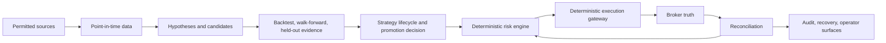

# Auvexo Alpha

Auvexo Alpha is a private, single-owner research and validation desk for BTC, ETH and
gold, built so that trading could one day be automated behind hard gates. Its job is to
find reproducible edges honestly and to preserve capital, including by returning no trade.
Profitability is an empirical question that has not been answered: no strategy here is
assumed or shown to be profitable.

The design is agentic outside and deterministic inside. Agents and models investigate
and propose. Typed, deterministic risk gates and execution adapters keep all authority.
There is no path from a model to an order.



## Where it stands

**[docs/STATUS.md](docs/STATUS.md) is the single statement of current status.** In short:
the engineering foundation, data collection, backtesting, PAPER risk core, an offline
execution foundation, a read-only operator terminal, an open-interest collector and a
read-only MT5 adapter exist as tested code. Nothing is connected to a broker. No order
can be placed in any mode. Four research results are inconclusive and no strategy has
been promoted. Operational evidence campaigns are registered but not accruing. The system
is not live certified.

## Start here

| If you want to | Read |
| --- | --- |
| Know what is true today, what is open and what is blocked | [Status](docs/STATUS.md) |
| Understand the product and its boundaries | [Constitution](docs/PRODUCT_CONSTITUTION.md), [architecture](docs/ARCHITECTURE.md) |
| See the phases and what each must prove | [Roadmap](docs/ROADMAP.md) |
| Run checks, operate or recover | [Runbooks](docs/runbooks/README.md) |
| Find a decision | [ADR index](docs/adr/README.md), [decisions and gates](docs/OPEN_DECISIONS.md) |
| Find any document | [Document index](docs/README.md) |
| Read the independent audit | [Rebaseline audit, 2026-11-12](docs/reviews/AUVEXO_FULL_A_TO_Z_REBASELINE_2026-11-12.md) |

## Layout

| Path | Contents |
| --- | --- |
| `src/auvexo_alpha/domain` | Typed contracts and pure rules. No framework, storage or provider imports. |
| `src/auvexo_alpha/application` | Use cases over domain ports. |
| `src/auvexo_alpha/infrastructure` | PostgreSQL, HTTP, Windows and provider adapters. |
| `src/auvexo_alpha/api` | Loopback, bearer-protected, read-only API. |
| `migrations` | Alembic migrations. Forward only. |
| `tools` | Local operating and verification tools. |
| `tests` | Unit, property, native Windows and PostgreSQL integration tests. |
| `web/operator-terminal` | Read-only operator terminal (React, TypeScript, Vite). |
| `docs` | Canonical documents, ADRs, runbooks, phase records and reviews. |

## Verify

```text
.venv\Scripts\python.exe -m ruff format --check src tests tools migrations
.venv\Scripts\python.exe -m ruff check src tests tools migrations
.venv\Scripts\python.exe -m mypy
.venv\Scripts\python.exe tools\run_tests.py -q -m "not integration"
node tools\check-docs.mjs
```

See [local verification](docs/runbooks/LOCAL_VERIFICATION.md) for the frontend, the
PostgreSQL-backed tests and the rules that protect the operational checkout. These checks
validate the repository. They do not establish trading safety or profitability.

## Constraints

Free-first and local-first: Python 3.13, PostgreSQL 17, Parquet, CPU only, a 16 GB
laptop, no mandatory paid cloud, data or model service. Exness real execution is locked.
Binance live derivatives are BLOCKED_BY_POLICY. There is no withdrawal or transfer
capability.
