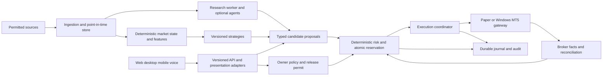

# Architecture

## CURRENT IMPLEMENTATION STATUS — 2026-11-03

PR11 is verified NORMAL MERGED at `fa0915130c9572c9c2a4a260b20abeaefc2c62f5`, following
all-step passing administrative CI41516596112 at f9a8609. Original DS03/OI design freezes
remain unchanged. ADR029/actual requirements/provider/runbook froze BEFORE code at
`aa1c5f4b4f003b660bd1a584647e62093894bb6c`. Actual MT5 read-only CODE, Windows-only pinned
SDK/NumPy, fixed native DPAPI/metadata/authority and isolated provider child are implemented
on `phase-2/ds03-mt5-readonly-adapter`; fresh independent executable review remains pending.
See `docs/phase2/DS03_ACTUAL_ADAPTER_IMPLEMENTATION.md` (repository-root path). Keep new PR
OPEN/UNMERGED. No actual SDK initialize/login/session, production credential API or broker
account data in public verification. SDK import-only and synthetic/native proofs confer no
actual qualification or trading authority. All existing operational, PRIVATE-onboarding,
OI clock/START, phase/value/live and money gates below remain unchanged.

## CURRENT STATUS SUPERSESSION — 2026-11-03

The latest owner-supplied macro records GPT-5.6 Sol's fresh independent acceptance of
`ba66f44fd38c761821913f5b9ef6c7dcf485ed2a`, tree
`d57091a9a488744b1050d652d876f94253b11656`:
PHASE2_DS03_SYNTHETIC_READONLY_ENGINEERING_ACCEPTED_PASS. See the acceptance record
at `docs/reviews/PHASE_2_DS03_SYNTHETIC_READONLY_INDEPENDENT_ACCEPTANCE.md` (repository-root
path). This accepts generic/synthetic engineering only. Actual DS-03 account/source/rights/
terminal/history qualification, Phase 2 exit, Phase 4 closure and Phase 5 commissioning
remain OPEN or NOT STARTED as applicable; synthetic evidence earns ZERO genuine credit.

PR #10 normal merge remains verified at `f47770d7886d12240e24390e23f939cb49535a31`.
The owner authorizes a docs-only administrative child on PR #11, actual green public CI,
then NORMAL merge with ordered parents that prior main and exact administrative head,
and equal merge/head trees. Retain frozen ADR-028/DS03 design/provider/runbook bytes and
all five frozen OI research files. No executable/test/dependency/workflow/migration change
in that acceptance step. Do not request another review merely to accept exact ba66.

After verified PR #11 merge only, create `phase-2/ds03-mt5-readonly-adapter`, freeze
ADR-029/actual-adapter requirements/provider review/runbook BEFORE code, and implement
production-capable read-only adapter CODE, fixed production DPAPI/local metadata and
onboarding-authority contracts. Exact official MetaTrader5 5.0.6231 Windows-only package
adoption/import-only proof is authorized; it is not a read-only security boundary.
No actual initialize/login/terminal session, account input, real secret storage or broker
data in this public engineering. Every future initialize requires explicit fixed terminal,
login/read-only password/server/timeout/portable choice; no discovery/account fallback or
trade operation. The new PR stays OPEN/UNMERGED for fresh exact-SHA independent review.

ADR-027 temporary PUBLIC governance continues through sanitized adapter engineering and
free CI. No new machine identifiers, real secrets/private broker data/confidential alpha;
source/history scans before every public push. No settings, billing, runner, permission,
visibility or branch-protection changes. Existing historical metadata retention remains
owner-authorized. PRIVATE return is required only before later actual account/session/
credential onboarding after PR12 acceptance and separate authority; do not ask earlier.
LIVE_RELEASE_INTEGRITY_CONTROL_REQUIRED_BEFORE_PHASE8 remains a future gate.

Operational release/tasks remain pinned to `9b9038b6966843805c99f15e1c37cdba7c026679`
and untouched; current Phase 2 genuine credit and Phase 4 count/span/replay/mismatch UNKNOWN,
not ZERO. Independent OI Runtime stays prepared/pinned to f47770d with Python3.13.16 and
PG17.11; no update, real OI DB/secrets/config/task/START. CLOCK_EXTERNAL_BLOCKED and
PHASE6_FORWARD_CLOCK=ZERO; no deep clock loop, at most one fresh read-only status.
Clock failure does not block this safe engineering. Protect20:45–22:15 and22:45–23:20 PKT.
Four Phase 3 outcomes INCONCLUSIVE, both OOS permanently consumed, no candidate/champion;
OI-FWD-v1/OI-16 unchanged and value gate OPEN. No actual Phase5 orders before full Phase4,
accepted actual DS03 and explicit authority. No REAL/money/live/runtime-AI authority.
Earlier dated sections retain historical facts and are superseded only for current scope.

## CURRENT STATUS SUPERSESSION — 2026-11-02

The owner-supplied latest macro brief records GPT-5.6 Sol's fresh exact-SHA independent
review: `b3e8cc1cfa503b1fecfec980e266345280f8dbd6` is
PHASE6A1_EXECUTABLE_ENGINEERING_ACCEPTED_PASS. See the implementation acceptance
record in `docs/reviews/PHASE_6A1_OI_IMPLEMENTATION_INDEPENDENT_ACCEPTANCE.md` and
ADR-027 in `docs/adr/027-temporary-public-ci-and-sanitized-engineering.md` (paths from
repository root). This is executable engineering acceptance only; OI collection,
commissioning, task registration and owner START are not established by this PASS.

Repository visibility is owner-authorized TEMPORARY PUBLIC for standard free hosted CI
and sanitized generic/synthetic engineering. Long-term intent remains PRIVATE. This
supersedes earlier present-tense PRIVATE claims and the old October 24 public-return gate
only within ADR-027's scope. No billing, runner, workflow, permissions or visibility change
is authorized. Prior public copies cannot be revoked. Retention of existing historical
machine/user metadata is owner-authorized; publish no NEW machine identifiers, real
secrets, private broker/account/session data or proprietary confidential alpha.

Materialize this acceptance with a docs-only child on PR #10; require actual passing
hosted executable CI, then NORMAL merge with ordered parents old main `63fd627d0166efcfe716886af31ba96f299c79da`
and exact administrative head, and equal merge/head trees. No executable or frozen OI
file changes in that administrative step. After verified merge only, prepare a separate
merge-pinned OI runtime and generic/synthetic DS-03 read-only engineering on
`phase-2/ds03-exness-demo-readonly`; keep its PR OPEN/UNMERGED for exact-SHA review.
Actual MT5 account/session/credential onboarding and confidential alpha require PRIVATE
return and separate accepted onboarding authority. No actual broker connection here.

OI-FWD-v1 and OI-16 remain exact. PHASE6_FORWARD_CLOCK=ZERO until independently accepted
owner START. Clock trust is required for real OI commissioning/START; clock failure does
not block unrelated safe engineering. No predictability-to-price/trading/filter/safety
value inference or Phase 6 completion. VALUE_ABLATION_PREREGISTRATION_BLOCKED_MECHANISM
remains OPEN. Four Phase 3 outcomes remain INCONCLUSIVE; both OOS holdouts are permanently
consumed; no candidate/champion exists. Phase 2/4 full operational gates remain OPEN and
current genuine credit/count/span/replay/mismatch UNKNOWN, not ZERO. Phase 5 actual
commissioning is NOT STARTED; full Phase 7 remains OPEN; Phases 8/9 NOT STARTED.

Operational release remains pinned at `9b9038b6966843805c99f15e1c37cdba7c026679` and
untouched: no update, task/config/activation changes, backfill, catch-up or retiming.
Protect 20:45–22:15 and 22:45–23:20 Asia/Karachi from heavy local work. No broker trading
credentials, REAL account, funding, order, withdrawal, runtime AI or money authority.
Binance live derivatives remain BLOCKED_BY_POLICY. SYSTEM_READY is not LIVE_CERTIFIED;
no edge means no live launch. Earlier dated sections below retain historical facts and
are superseded only for present status and the precise authority stated here.

## CURRENT STATUS SUPERSESSION — 2026-10-27

- Repository haseeb1229/auvexo-alpha is independently verified PRIVATE, reconfirmed by authenticated GitHub API for this correction. The former temporary PUBLIC exception/governance-return gate is resolved by the verified owner return to PRIVATE; prior public copies cannot be revoked.
- Phase 6A1 source/feature-foundation design is independently ACCEPTED/FROZEN at 887b6ac38636e07ff922d2ba2d0ec7b2063edd4f (GPT-5.6 Sol, founder-supplied disposition). PR #9 normally merged at 63fd627d0166efcfe716886af31ba96f299c79da; main is pinned there for this engineering checkpoint. The documentation-only private-CI infrastructure exception is explicit, not an executable-CI waiver.
- Phase 6A1 source/feature-foundation executable engineering is implemented on phase-6/ds04-open-interest-engineering, pending independent exact-SHA code review; it is NOT accepted or enabled. DS-04 data collection/task remain NOT STARTED; PHASE6_FORWARD_CLOCK=ZERO. Broad DS-04 rights remain unresolved/excluded; only DS-04-A1 current OI snapshot source-specific NONPRODUCTION rights/design are accepted.
- OI-FWD-v1 is SOURCE/FEATURE PREDICTABILITY FOUNDATION only. PASS_RESEARCH_PREDICTABILITY proves no price alpha, trading/filter/promotion/safety value or canonical Phase 6 incremental-value exit. It cannot enable operational OI, promote a strategy/candidate, enable a module or justify progression to macro/news/agents on OI-value grounds.
- That value gate remains OPEN pending a separately authorized, preregistered paired baseline-vs-OI augmented ablation on admissible future/unconsumed evidence, causally correct, cost/latency aware where applicable, dependence-aware and no-retune, under then-current rights and accepted dependencies. No baseline selection from Phase 3 consumed OOS performance; both consumed holdouts remain permanently unavailable for selection/reuse. The authorized outcome-blind mechanism review records VALUE_ABLATION_PREREGISTRATION_BLOCKED_MECHANISM; no OI-to-price rule or later study execution is invented.
- Phase 2 full operational acceptance remains OPEN; current genuine count UNKNOWN unless later independently proven. Phase 4 full operational acceptance remains OPEN; current qualifying count/span/replay UNKNOWN unless later independently proven. This correction earns ZERO calendar/qualification credit.
- Phase 5 commissioning remains NOT STARTED; DS-03 remains BLOCKED. Binance live derivatives remain BLOCKED_BY_POLICY. No broker/MT5/Exness/order/money/runtime-AI authority; no macro/news/agent runtime.
- Private hosted CI for PR #9 is EXTERNALLY_BLOCKED / PRIVATE_CI_UNAVAILABLE at reviewed run 40495351201 / job 122159293913: completed FAILURE with ZERO executable steps, no hosted test result and no hosted PASS. Codex observed the account billing/spending annotation; independent review confirmed the zero-step failure. Any automatic correction-head run requires separate factual reporting. No manual rerun or visibility/billing/settings/workflow change to manufacture CI.

Older PUBLIC/current-entry, phase-status and governance wording below is retained as historical context and evidence. This dated block supersedes that wording ONLY for present status; it does not rewrite historical facts, frozen acceptances, source rights or operational/financial gates.

Phase4 engineering is independently accepted; actual-feed observation is ACTIVE on the
separate pinned operational checkout at `9b9038b6966843805c99f15e1c37cdba7c026679`.
Full Phase4 remains OPEN pending genuine dates/span/replay/zero mismatch. The separate
development clone is authorized only for Phase5 OFFLINE/PRE-COMMISSIONING engineering
under [ADR-024](adr/024-parallel-operational-release-and-engineering.md) and [offline requirements](phase5/OFFLINE_ACCEPTANCE.md).
Actual Phase5 commissioning and sustained-demo evidence are NOT STARTED. Broker
SDK/session/order capability is absent; no credentials or money authority. Phase2 full
operational OPEN/DS03 BLOCKED; Phase3 four INCONCLUSIVE outcomes, both OOS consumed,
no candidate/champion. PUBLIC governance review due2026-10-24 and DS02 rights review
due2026-11-16 remain unwaived. Never alter/repoint the operational checkout/task/config/
activation from this development lane. Dated handoffs retain their original historical facts.

Status: FROZEN boundaries; Phase 1 stack pinned and exercised in
[toolchain evidence](phase1/TOOLCHAIN.md). [Implemented subset](phase1/IMPLEMENTATION.md)
records the historical foundation. The [Phase 2 data subset](phase2/IMPLEMENTATION.md)
adds bounded public data collection and immutable research storage. Phase 4 Checkpoint A implements the isolated virtual PAPER subset under
[ADR-015](adr/015-paper-risk-core.md), independently accepted for Checkpoint A at
`e3f39e0397e1846c37febcebc246ea91c9f2eb78`; see the
[acceptance record](reviews/PHASE_4_CHECKPOINT_A_INDEPENDENT_ACCEPTANCE.md).
Full Phase 4 remains OPEN; actual-feed observation is ACTIVE on the pinned release. Checkpoint B
engineering is independently accepted at 527bd23ce434fee557f6f1414bf5b43d7c3c3f21;
see its [acceptance record](reviews/PHASE_4_CHECKPOINT_B_INDEPENDENT_ACCEPTANCE.md).
PR #6 merged normally at `9b9038b6966843805c99f15e1c37cdba7c026679`.
Preparation and separate owner START have completed; the operational campaign and
registered task remain pinned there. ADR-024 permits only physically separate offline
engineering. The current gateway process is synthetic and inspection-only; actual broker
gateway commissioning and money authority remain future gated work.

Use a modular monolith with a separate bounded research worker and a separate Windows
MT5 gateway process. This is process isolation for safety and resource limits, not a
microservice platform. Start Windows-native Python/PostgreSQL; Docker/WSL2 is optional
for reproducible tests after measuring overhead. The MT5 terminal/gateway stays Windows
native. One deployment can later move the core to Linux while retaining a secured
Windows gateway, without changing domain contracts.

Dependency direction: clients -> API contracts -> application use cases -> domain ports.
Adapters implement ports; domain imports neither FastAPI, storage drivers, MT5, LLM SDKs
nor UI. Risk is deterministic and has no provider calls. The future operational gateway
will be the sole execution-credential holder with a narrow authenticated command protocol. Research has read-only snapshots
and a proposal/job API, no risk-write, execution, production filesystem or secret access.
Logical modules: instruments/policy; ingestion; features; research; strategies; risk;
execution; reconciliation; journal; identity; operations; optional agent tools.

## Stack direction and reasons

| Area | Selected direction | Alternative/defer rationale and proof |
| --- | --- | --- |
| Core | Supported CPython; strict typing; Decimal at financial boundaries | Ecosystem and testability; isolate blocking MT5 IPC; no Rust/C++ rewrite without profiling |
| API | FastAPI, Pydantic strict DTOs; OpenAPI and JSON Schema | Contract generation; explicit domain constructors still validate invariants; no coercion-based money parsing |
| Persistence | Plain PostgreSQL, SQLAlchemy, Alembic; numeric and UTC timestamptz | Transactions and constraints for reservations/outbox; SQLite insufficient as production concurrency proof |
| Research | NumPy, Polars, SciPy; statsmodels/scikit-learn when experiment needs them | Parquet column pruning; Pandas only for a justified interoperability boundary; no duplicate dataframe pipelines |
| Archives | Parquet with Zstandard; hashed manifests; local filesystem | Cheap portable research storage; object-store adapter later |
| Jobs | PostgreSQL durable job/outbox tables, bounded in-process queues | In-memory delivery alone cannot survive restart; Redis/NATS JetStream deferred until measured bottleneck or independent consumers |
| Web later | React, TypeScript, Vite; TanStack Query/Table, Tailwind, accessible primitives | Pure client; no server rendering requirement for a private terminal |
| Charts later | Lightweight Charts for price; ECharts for research plots if needed | Review attribution/bundle/license at adoption; avoid two chart libraries without distinct need |
| Other clients | Tauri desktop; React Native/Expo Android APK; voice adapter later | Validate security, packaging and native support in Phase 7, not now |
| Quality | pytest, Hypothesis where useful, Ruff, mypy, dependency/secret scans | Lock exact versions and tooling in Phase 1; no dependencies installed in Phase 0 |
| Operations | Structured logs, OpenTelemetry boundaries, simple metrics endpoint | Prometheus/Grafana only if operations needs justify memory; Docker optional; GitHub Actions within free allowance |
| ML/AI | Provider-neutral structured inference port; optional local/pretrained models | No foundation-model training; no paid provider requirement; no heavyweight agent framework initially |

[FastAPI](https://fastapi.tiangolo.com/features/) exposes OpenAPI contracts;
[Pydantic strict validation](https://docs.pydantic.dev/latest/concepts/strict_mode/)
helps reject coercions but requires tests for JSON-specific behavior.
[PostgreSQL concurrency](https://www.postgresql.org/docs/current/mvcc.html) supports
transactional state; locking strategy remains ours. Select a supported major and current
patch using the [support policy](https://www.postgresql.org/support/versioning/) in Phase 1.
Timescale is deferred: three assets do not yet justify extension operations or
[edition/license differences](https://github.com/timescale/timescaledb/blob/main/LICENSE).
Partition/index plain PostgreSQL and measure before changing it. Exact package versions
were selected with compatibility install/test evidence in Phase 1/2; the current lock is
accepted under an explicit [maturity exception](amendments/DEPENDENCY_MATURITY.md), not age alone.

## Application contracts (design, not runnable schemas)

Every command/event carries schema_version, event/command_id, correlation_id, causation_id,
created_at UTC, source identity, environment, account_ref where relevant and payload_hash.
Unknown major versions fail validation; minor additions must be optional and compatible.
Consumers deduplicate event IDs and detect sequence gaps; reconnect uses cursor replay
then a consistent snapshot. UI reconnect never replays money-changing commands blindly.

| Contract | Minimum content and invariant |
| --- | --- |
| InstrumentSpec | venue, instrument_id, broker symbol, product type, quote/base/account currencies, contract multiplier, tick/lot/min/max, sessions, margin/fill modes, version and observed_at; BTC spot is not an Exness CFD |
| MarketState / FeatureSnapshot | immutable IDs, as_of/available_at, source watermark, feature/code/dataset versions, health, missingness and lineage |
| TradeCandidate | candidate_id, strategy/release version, evidence refs, proposed side/size/stop/expiry; no broker payload or authority |
| TradeIntent | canonical immutable hash, mode/account/venue/product, action, quantity/price constraints, stop, time-in-force, snapshot and policy refs, expiry and idempotency key |
| RiskAuthorization | bound intent hash, account epoch, risk-policy version, reservation ID, maximum quantity/notional/loss, expiry, capability signature; gateway verifies all fields |
| ExecutionReport | intent and attempt IDs, native order/deal IDs, broker time, received_at, quantities/fees, explicit status and raw response hash |
| LiveTradingPermit | account/server identity, venue/product allowlist, release/config hashes, limits, evidence manifest, validity/revocation epoch and owner signature |
| AgentRun | identity/tool grants, model/prompt versions, budgets, evidence refs, structured outcome and timings |

REST `/api/v1` owns read models and authenticated commands. WebSocket envelopes carry
read events with sequence/resume semantics. No browser API exposes arbitrary order_send.
Policy changes create proposals; approval/activation is a separate authenticated use case.
Errors include stable code, retryable flag, correlation ID and safe detail; never secrets.

## Atomicity and extension points

Persist intent, authorization/reservation and outbox in one database transaction, serialized
by account risk lock. Unique account+intent/action key prevents duplicate logical orders.
One gateway writer per account; durable epoch/fencing blocks a stale writer. Before send,
recheck permit, freshness, epoch and bound limits. DB transactions cannot atomically commit
with a broker: unknown outcomes must reconcile, not claim exactly-once external delivery.
Restart defaults to reconciliation-only and reattests the account before readiness.

Small typed ports: MarketDataSource, ExecutionVenue, FeatureDefinition, Strategy,
ModelProvider, ResearchTool, NotificationSink. Registration requires an explicit manifest,
schema, permissions, timeout and contract tests; no runtime arbitrary plugin downloads.
Use Python protocols and explicit registry configuration before general plugin machinery.
Future Auvexo consumers receive redacted versioned summaries under separate identities;
no DB access, shared owner credential or execution power by default. Outbox events can
later feed a bus without rewriting strategy/risk logic. See [ADRs](adr/README.md).
