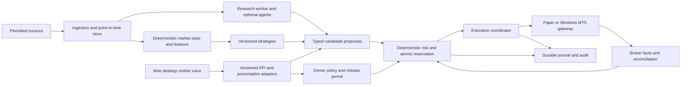

# Architecture

Status: FROZEN boundaries; Phase 1 stack pinned and exercised in
[toolchain evidence](phase1/TOOLCHAIN.md). [Implemented subset](phase1/IMPLEMENTATION.md)
contains contracts, disabled boundaries and diagnostics only. The worker/gateway/data/risk
components below remain future architecture, not installed services.

Use a modular monolith with a separate bounded research worker and a separate Windows
MT5 gateway process. This is process isolation for safety and resource limits, not a
microservice platform. Start Windows-native Python/PostgreSQL; Docker/WSL2 is optional
for reproducible tests after measuring overhead. The MT5 terminal/gateway stays Windows
native. One deployment can later move the core to Linux while retaining a secured
Windows gateway, without changing domain contracts.

Dependency direction: clients -> API contracts -> application use cases -> domain ports.
Adapters implement ports; domain imports neither FastAPI, storage drivers, MT5, LLM SDKs
nor UI. Risk is deterministic and has no provider calls. Gateway has only execution
credentials and a narrow authenticated command protocol. Research has read-only snapshots
and a proposal/job API, no risk-write, execution, production filesystem or secret access.
Logical modules: instruments/policy; ingestion; features; research; strategies; risk;
execution; reconciliation; journal; identity; operations; optional agent tools.

## Stack direction and reasons

| Area | Selected direction | Alternative/defer rationale and proof |
| --- | --- | --- |
| Core | Supported CPython; strict typing; Decimal at financial boundaries | Ecosystem and testability; isolate blocking MT5 IPC; no Rust/C++ rewrite without profiling |
| API | FastAPI, Pydantic strict DTOs; OpenAPI and JSON Schema | Contract generation; explicit domain constructors still validate invariants; no coercion-based money parsing |
| Persistence | Plain PostgreSQL, SQLAlchemy, Alembic; numeric and UTC timestamptz | Transactions and constraints for reservations/outbox; SQLite insufficient as production concurrency proof |
| Research | NumPy, Polars, SciPy; statsmodels/scikit-learn when experiment needs them | Parquet column pruning; Pandas only for a justified interoperability boundary; no duplicate dataframe pipelines |
| Archives | Parquet with Zstandard; hashed manifests; local filesystem | Cheap portable research storage; object-store adapter later |
| Jobs | PostgreSQL durable job/outbox tables, bounded in-process queues | In-memory delivery alone cannot survive restart; Redis/NATS JetStream deferred until measured bottleneck or independent consumers |
| Web later | React, TypeScript, Vite; TanStack Query/Table, Tailwind, accessible primitives | Pure client; no server rendering requirement for a private terminal |
| Charts later | Lightweight Charts for price; ECharts for research plots if needed | Review attribution/bundle/license at adoption; avoid two chart libraries without distinct need |
| Other clients | Tauri desktop; React Native/Expo Android APK; voice adapter later | Validate security, packaging and native support in Phase 7, not now |
| Quality | pytest, Hypothesis where useful, Ruff, mypy, dependency/secret scans | Lock exact versions and tooling in Phase 1; no dependencies installed in Phase 0 |
| Operations | Structured logs, OpenTelemetry boundaries, simple metrics endpoint | Prometheus/Grafana only if operations needs justify memory; Docker optional; GitHub Actions within free allowance |
| ML/AI | Provider-neutral structured inference port; optional local/pretrained models | No foundation-model training; no paid provider requirement; no heavyweight agent framework initially |

[FastAPI](https://fastapi.tiangolo.com/features/) exposes OpenAPI contracts;
[Pydantic strict validation](https://docs.pydantic.dev/latest/concepts/strict_mode/)
helps reject coercions but requires tests for JSON-specific behavior.
[PostgreSQL concurrency](https://www.postgresql.org/docs/current/mvcc.html) supports
transactional state; locking strategy remains ours. Select a supported major and current
patch using the [support policy](https://www.postgresql.org/support/versioning/) in Phase 1.
Timescale is deferred: three assets do not yet justify extension operations or
[edition/license differences](https://github.com/timescale/timescaledb/blob/main/LICENSE).
Partition/index plain PostgreSQL and measure before changing it. Exact package versions
are intentionally not frozen without a compatibility install/test matrix.

## Application contracts (design, not runnable schemas)

Every command/event carries schema_version, event/command_id, correlation_id, causation_id,
created_at UTC, source identity, environment, account_ref where relevant and payload_hash.
Unknown major versions fail validation; minor additions must be optional and compatible.
Consumers deduplicate event IDs and detect sequence gaps; reconnect uses cursor replay
then a consistent snapshot. UI reconnect never replays money-changing commands blindly.

| Contract | Minimum content and invariant |
| --- | --- |
| InstrumentSpec | venue, instrument_id, broker symbol, product type, quote/base/account currencies, contract multiplier, tick/lot/min/max, sessions, margin/fill modes, version and observed_at; BTC spot is not an Exness CFD |
| MarketState / FeatureSnapshot | immutable IDs, as_of/available_at, source watermark, feature/code/dataset versions, health, missingness and lineage |
| TradeCandidate | candidate_id, strategy/release version, evidence refs, proposed side/size/stop/expiry; no broker payload or authority |
| TradeIntent | canonical immutable hash, mode/account/venue/product, action, quantity/price constraints, stop, time-in-force, snapshot and policy refs, expiry and idempotency key |
| RiskAuthorization | bound intent hash, account epoch, risk-policy version, reservation ID, maximum quantity/notional/loss, expiry, capability signature; gateway verifies all fields |
| ExecutionReport | intent and attempt IDs, native order/deal IDs, broker time, received_at, quantities/fees, explicit status and raw response hash |
| LiveTradingPermit | account/server identity, venue/product allowlist, release/config hashes, limits, evidence manifest, validity/revocation epoch and owner signature |
| AgentRun | identity/tool grants, model/prompt versions, budgets, evidence refs, structured outcome and timings |

REST `/api/v1` owns read models and authenticated commands. WebSocket envelopes carry
read events with sequence/resume semantics. No browser API exposes arbitrary order_send.
Policy changes create proposals; approval/activation is a separate authenticated use case.
Errors include stable code, retryable flag, correlation ID and safe detail; never secrets.

## Atomicity and extension points

Persist intent, authorization/reservation and outbox in one database transaction, serialized
by account risk lock. Unique account+intent/action key prevents duplicate logical orders.
One gateway writer per account; durable epoch/fencing blocks a stale writer. Before send,
recheck permit, freshness, epoch and bound limits. DB transactions cannot atomically commit
with a broker: unknown outcomes must reconcile, not claim exactly-once external delivery.
Restart defaults to reconciliation-only and reattests the account before readiness.

Small typed ports: MarketDataSource, ExecutionVenue, FeatureDefinition, Strategy,
ModelProvider, ResearchTool, NotificationSink. Registration requires an explicit manifest,
schema, permissions, timeout and contract tests; no runtime arbitrary plugin downloads.
Use Python protocols and explicit registry configuration before general plugin machinery.
Future Auvexo consumers receive redacted versioned summaries under separate identities;
no DB access, shared owner credential or execution power by default. Outbox events can
later feed a bus without rewriting strategy/risk logic. See [ADRs](adr/README.md).
