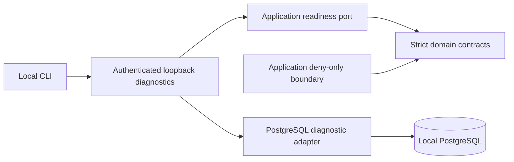

# Phase 1 implementation and contract boundaries

The implementation is a diagnostics foundation. Healthy status does not mean trading readiness.
All seven modes are typed; every money action is denied. There is no broker connection, order
transport, risk kernel, risk reservation, signer, live permit, strategy, collector or dashboard.

API wiring constructs infrastructure at the composition boundary. Domain uses stdlib and
Pydantic only; application imports domain and a small protocol. AST tests prohibit inward
web/storage dependencies. A JSON schema snapshot is generated from the same seven models,
with a drift assertion; it is not a parallel manually maintained contract.

| Component | Source and current responsibility | Tests |
| --- | --- | --- |
| Strict contracts | [contracts](../../src/auvexo_alpha/domain/contracts.py): Mode, instrument, market/feature metadata, candidate/intent, inert risk authorization and report shapes | [contracts tests](../../tests/test_contracts.py), [schema](../../tests/test_schema.py) |
| Denials | [safety](../../src/auvexo_alpha/application/safety.py), [errors](../../src/auvexo_alpha/domain/errors.py): deterministic typed denial, explicit Binance policy | [all modes/actions and malformed input](../../tests/test_disabled.py) |
| Config | [settings](../../src/auvexo_alpha/config.py): bounded loopback settings, rejected unknown keys, redacted secrets | [API/config](../../tests/test_config_api.py), [CLI](../../tests/test_cli.py) |
| Diagnostics | [API](../../src/auvexo_alpha/api/app.py), [CLI](../../src/auvexo_alpha/cli.py): five authenticated read-only routes, actual readiness | API/config, CLI and real DB tests |
| Storage | [adapter](../../src/auvexo_alpha/infrastructure/database.py), [migration](../../migrations/versions/0001_foundation.py) | [PostgreSQL](../../tests/test_postgres.py), [recovery tool](../../tools/verify_recovery.py) |
| Boundaries | src-layout package with no broker dependency | [AST/package checks](../../tests/test_boundaries.py) |
| Developer tooling | [bootstrap](../../tools/bootstrap.ps1), [commands](../../tools/dev.ps1), [local DB](../../tools/local_db.py), [measurements](../../tools/measure_foundation.py) | Actual Windows installation, service smoke, clean clone and recovery |
| Quality/security | [CI](../../.github/workflows/foundation.yml), [docs](../../tools/check-docs.mjs), [source scan](../../tools/secret_scan.py), dependency audit | Local results and exact CI run in verification |

Contracts reject unknown fields and schema versions, floats/integers/bools as money, NaN,
infinity, exponent strings, overlarge precision, invalid currencies/units, naive/nonzero-offset
timestamps and impossible point-in-time ordering. Python accepts finite bounded Decimal
instances; JSON accepts plain decimal strings. Amount magnitudes are below 10^18, precision
at most 18 fractional places; instrument bounds align to steps under a private decimal context.
The small currency/product list is a shape allowlist, not trading eligibility or market coverage.

Identifiers are canonical lowercase UUIDs. Envelopes carry correlation/causation, source,
mode, creation and expiry; expiry checks take an injected clock value. Evidence references
identify dataset/strategy/model versions without collecting data. Market metadata enforces
`source_watermark <= as_of <= available_at <= decision_at`; actual point-in-time data engines
remain Phase 2/3. Candidate stop/entry fields are shapes, not validated trading risk decisions.

Canonical bytes use sorted JSON keys, compact separators, ASCII escaping, all default/null
fields included, decimal strings with trailing fractional zeros removed and negative zero
normalized, UUID lowercase, UTC timestamps with six fractional digits and `Z`. Tuple order is
preserved. SHA256 identifies content only: no signature, authentication or permit security claim.
Financial JSON schema advertises strings; custom cross-field invariants are enforced at runtime.

The deny boundary returns INVALID_INPUT for malformed inputs, BLOCKED_BY_POLICY for Binance
perpetual LIVE/LIVE_LIMITED, otherwise NOT_AVAILABLE. All returns have status DENIED and
retryable false, including repeat command IDs, missing permits and any nominal account label.
An account label is an opaque shape field; there is no connected account registry. Even a
valid RiskAuthorization instance grants zero capability. Reports are external fact shapes;
the application never generates a successful broker fill.

Readiness queries real schema version, immutable disabled policy and app-role flags, reporting
NOT_READY on database errors. Tests cover missing DB and restore/schema integrity. This is not
a full intrusion detector or proof against a hostile local administrator. Loopback peer/Host,
Origin rejection and constant-time bearer comparison protect current diagnostics. Proxies and
forwarded headers cannot confer trust. TLS and full owner identity belong to later deployment.

Strict mypy covers all production code and migrations. Test harnesses/scripts are linted,
executed and reviewed, but are not included in the strict mypy target; their dynamic fixtures
and subprocess orchestration do not grant production execution capabilities. No type ignores,
test skips, broad exception suppression or vulnerability exceptions are used.
