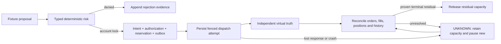

# Phase 4 Checkpoint A design and review map

Scope and proof criteria are frozen in [requirements](ACCEPTANCE_TESTS.md) and
[ADR-015](../adr/015-paper-risk-core.md). This map explains the engineering model;
completed checks and exact-source evidence must be recorded in the final handoff.
Synthetic examples are neither market observations nor investment recommendations.

## Authority and isolation

An immutable `PaperCandidate` is a proposal. `PaperIntent` binds virtual account,
mode/action, instrument/venue/product, logical key, quantity/entry/stop, release,
policy/spec/market/account hashes and time. The pure kernel computes a decision;
only the serialized database transaction may persist its bound reservation,
`PaperAuthorization` and outbox. `PAPER_NONEXTERNAL` is explicitly not a live
signature/capability. Foundation `deny_execution`, disabled settings and money-mode
policy remain unchanged; no HTTP order route, broker adapter or credentials exist.

TEST_ONLY fixtures belong to `PAPER_QUALIFICATION_FIXTURE`, ENGINEERING_ONLY,
PAPER-only. A physically separate production release registry starts empty. No
Phase 3 empirical artifact is imported. All four studies remain INCONCLUSIVE and
both OOS holdouts consumed forever. Lifecycle metadata and independently reviewed
eligible evidence can never override mode/venue/security/financial permissions.

Under [ADR-019](../adr/019-paper-lifecycle-filesystem.md), a production identity begins
once in RESEARCH. Each later snapshot binds an explicit legal transition to the latest
durable predecessor. Per-identity transaction locks serialize concurrent attempts;
snapshot/history writes are atomic. The current projection derives only from a complete,
hash-verified immutable chain. Suspension cannot create a shortcut into PAPER. Only
isolated synthetic tests exercise this production metadata; the project has no release
eligible for production promotion.

## Versioned calculation example

`paper.provisional.v1` carries the canonical test limits, separate per-asset bound,
freshness and queue budgets, round-trip fee/slippage assumptions and adverse gap stress.
The initial test spec is linear long-only SPOT, multiplier 1, quantity step 0.001;
it is a PAPER fixture, not an exchange/broker contract attestation.

For requested quantity 0.0109, round DOWN to 0.010. Entry 50000, stop 49000,
adverse quote-to-account FX 1.01 gives notional `0.010*50000*1.01 = 505` and
base stop risk `0.010*(50000-49000)*1.01 = 10.10`.
The policy's fee 10 bps each way, slippage 5 bps each way and gap 5 bps give
cost/stress `505*(2*10+2*5+5)/10000 = 1.7675`; modeled loss **11.8675**.
At virtual equity 10000, per-intent cap is 25, aggregate 100, BTC+ETH bucket 50,
daily marked loss 100 and high-water drawdown 500. Four such risk units total
47.4700; five total 59.3375 and exceed the bucket even before other limits apply.
The three-position and rate caps remain independently enforced. Stops do not
guarantee this modeled loss in a real market. Pending closes never create entry capacity.

## Ordered reason-code review matrix

The enum order is the stable decision evaluation/reporting order; a denied decision
may report multiple safely evaluable reasons. Structurally invalid or nonfinite input
cannot proceed to sizing or become a smaller guessed exposure.

| Group | Reason codes / expected refusal |
| --- | --- |
| Boundary and identity | INVALID_INPUT; MODE_MISMATCH; ACCOUNT_UNKNOWN; ACCOUNT_MISMATCH; HASH_MISMATCH |
| Eligibility and lifecycle | VENUE_PRODUCT_INELIGIBLE; RELEASE_INELIGIBLE; FIXTURE_MODE_BLOCKED; INTENT_EXPIRED |
| Data/spec health | MARKET_INVALID; MARKET_STALE; ACCOUNT_STALE; ACCOUNT_UNRECONCILED; SPEC_STALE; SPEC_UNSUPPORTED; FX_UNKNOWN; FX_STALE; CLOCK_OFFSET; SESSION_CLOSED |
| Financial semantics | PRICE_INVALID; QUANTITY_INVALID; STOP_INVALID; SHORT_UNSUPPORTED; FILL_UNSUPPORTED; MINIMUM_QUANTITY; MINIMUM_NOTIONAL |
| Durable/operational health | JOURNAL_UNHEALTHY; UNKNOWN_ORDER; DUPLICATE_INTENT; KILL_BLOCKED; ORDER_RATE_CAP |
| Capacity and losses | BALANCE_CAP; TRADE_RISK_CAP; ASSET_RISK_CAP; BUCKET_RISK_CAP; TOTAL_RISK_CAP; GROSS_CAP; NET_CAP; POSITIONS_CAP; MARGIN_CAP; DAILY_LOSS_CAP; DRAWDOWN_CAP |
| Bound reductions | POSITION_UNKNOWN; OVER_CLOSE; TARGET_UNKNOWN |

Every otherwise-valid denied fixture proposal retains its exact intent, decision time,
ordered reasons, policy/spec/snapshot/release hashes and engineering evidence lineage.
A hypothetical forward outcome remains UNOBSERVABLE unless separately observed with
the frozen virtual model. Overlapping rejected winners cannot be summed as portfolio profit.
No Phase 4 denial is fabricated for a Phase 3 study.

## Persistence and failure review

Account locks serialize risk decisions. Logical action uniqueness and immutable histories
are separate from mutable operational projections. The outbox and authorization commit
with capacity; failure before commit grants nothing. Attempts persist before simulation.
The simulator owns independent append-only truth; runtime reads it. Its order boundary
checks the persisted writer epoch and authorization so a stale claimed writer cannot send.

SENT_PENDING/UNKNOWN never resends blindly. UNKNOWN pauses entries and retains worst-case
capacity; PARTIAL combines actual exposure with residual capacity. Cancel-requested is
not CANCELED. Late fills and external facts append corrections, never erase earlier
observations. Restart bumps/fences the writer, pauses new exposure and requires reconciliation;
it never clears loss, kill, UNKNOWN or suspended state. Proven terminal truth alone can
release residual capacity. K4 blocks automated changes; K1-K3 reductions still require
fresh known position/journal truth and cannot over-close/reverse.

Recovery comparisons must cover all PAPER records, hashes/totals and mutation guards,
including unknown/crash state. Same-disk isolated DEV restore is not disaster recovery.
Benchmarks use SYNTHETIC fixture load and report samples, percentiles, CPU/RAM/disk,
burst/backpressure and competing/throttled research. Target misses remain explicit.

## Unchanged gates

No persistent task or 14-day count has begun. Phase 5 and broker onboarding remain
closed. Full Phase 2 B/C remains OPEN; daily task unchanged and qualifying dates must
come from genuine verified scheduled receipts. No heavy testing/migrations/benchmarks
22:45-23:20 Pakistan. Public-source exception review due 2026-10-24; no settings change.
GPT-5.6 Sol must review the exact final SHA before merge or persistent observation.
