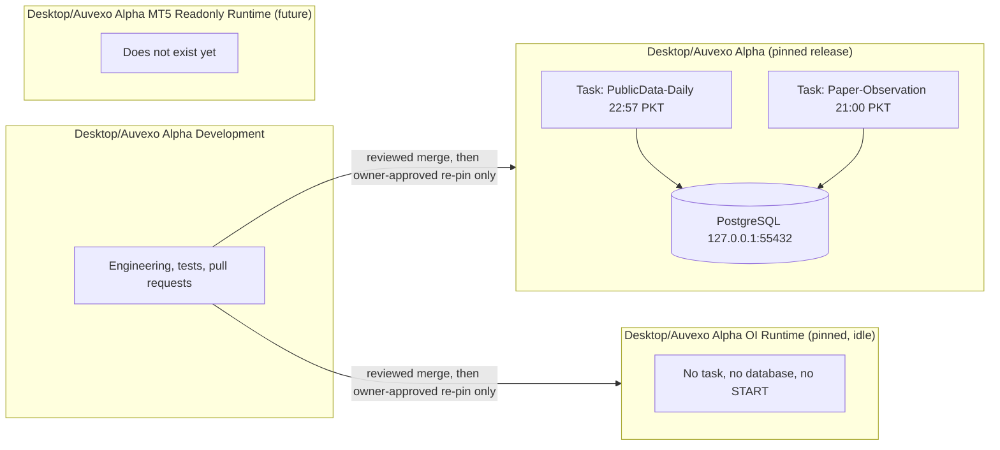

# Checkouts and scheduled tasks

Three separate clones of the repository live on the owner laptop. They are separate on
purpose: genuine evidence must come from a fixed, reviewed release while engineering
continues elsewhere.



## Rules

Operational and OI Runtime are immutable for engineering:

- no edit, format, fetch, pull, branch switch, reset, install, sync, test or migration;
- no change to tasks, campaign configuration, activation, schedule or timestamps;
- no backfill and no repair of evidence;
- read-only inspection only.

The pinning code enforces part of this. The scheduled PAPER run refuses if tracked source,
tools, migrations, lock file or agent instructions differ from the campaign commit. The
open-interest runtime refuses if its tree is dirty or its commit differs from its
configuration.

Git in the Operational checkout needs a per-command safe-directory option because its
`.git` directory is owned by a different local account. Do not add a global exception.
Use read-only commands only, with optional locks disabled:

```text
set GIT_OPTIONAL_LOCKS=0
git -c safe.directory="C:/Users/<owner>/Desktop/Auvexo Alpha" -C "<path>" rev-parse HEAD
git -c safe.directory="C:/Users/<owner>/Desktop/Auvexo Alpha" -C "<path>" status --porcelain
```

## Port 55432

Port 55432 on loopback belongs to the Operational PostgreSQL cluster. The Development
tooling uses the same port number. Therefore, in the Development checkout:

- never run `tools/local_db.py start`; it refuses when the port is in use, and it would
  otherwise create a second cluster on the Operational port;
- never run PostgreSQL integration tests on this laptop while the Operational cluster is
  up; they run as the cluster superuser;
- rely on hosted CI for the PostgreSQL-backed tests. CI uses an isolated container.

## Scheduled tasks

Both tasks run only while the owner is signed in. Inspect them without changing them:

```text
schtasks /query /tn "AuvexoAlpha-PublicData-Daily" /v /fo LIST
schtasks /query /tn "AuvexoAlpha-Paper-Observation" /v /fo LIST
```

On a night that should count, from 20:45 to 23:20 PKT keep the laptop on AC power, awake,
signed in and on its usual network. Do not sleep, hibernate, reboot, switch network or run
heavy work. The public-data task will not start on battery. The PAPER task does not wake
the machine. A night that is missed stays missed.
